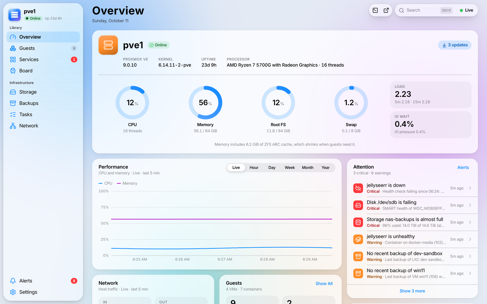
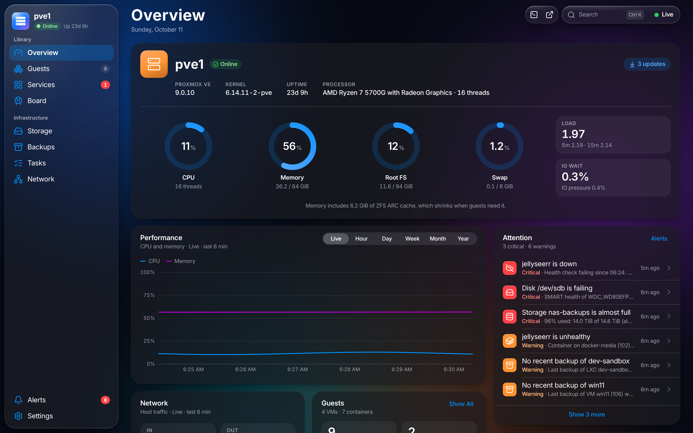
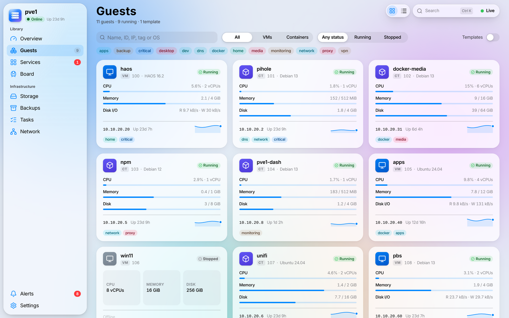
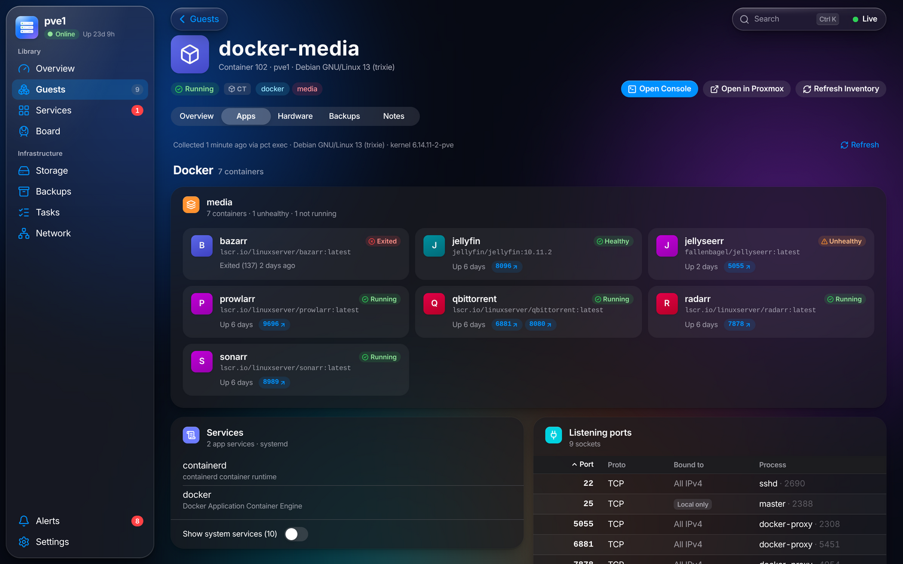
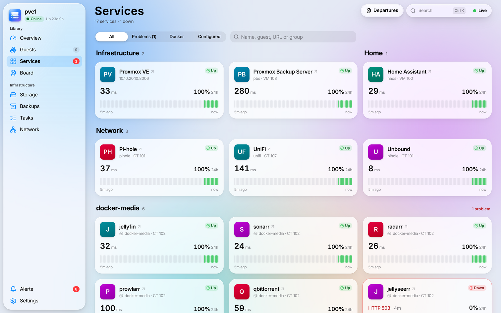
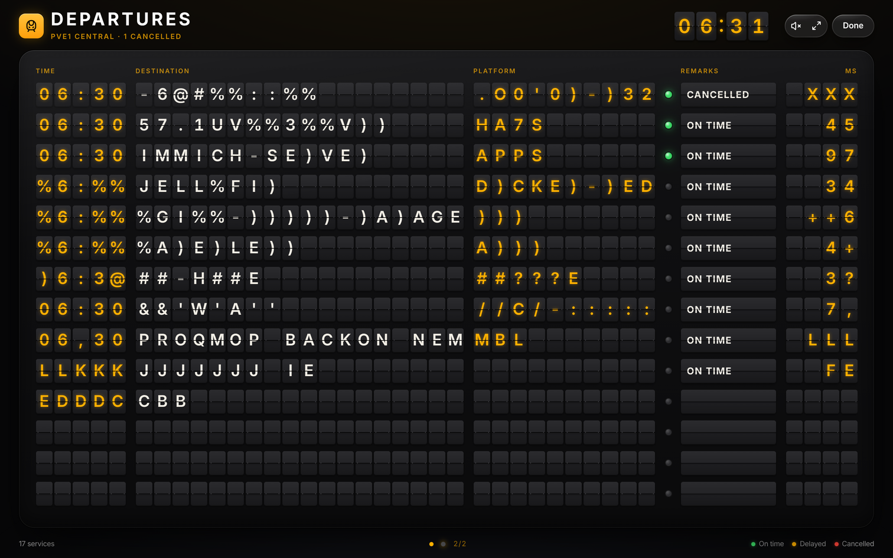
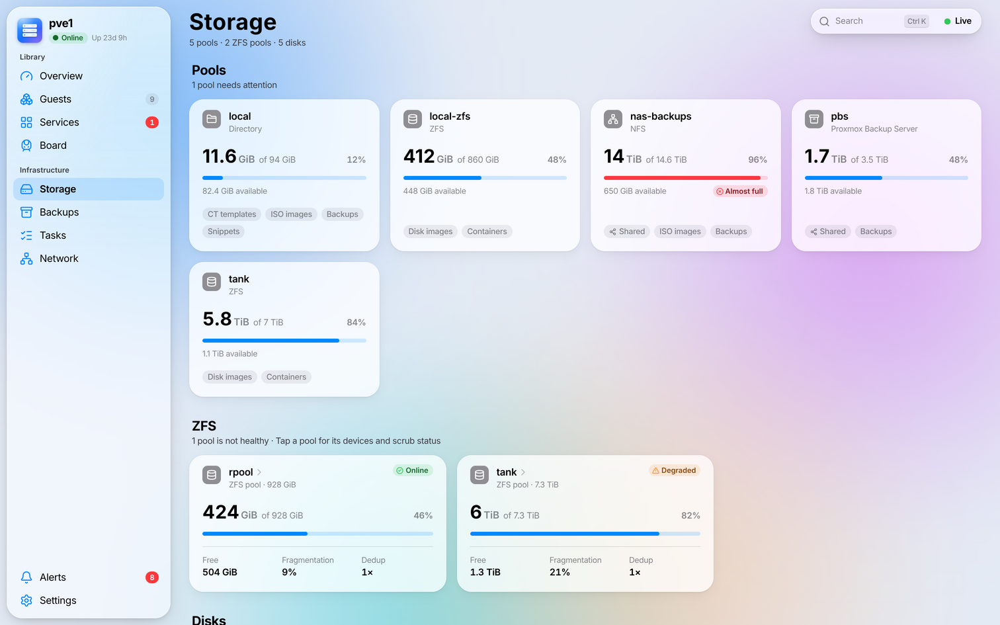
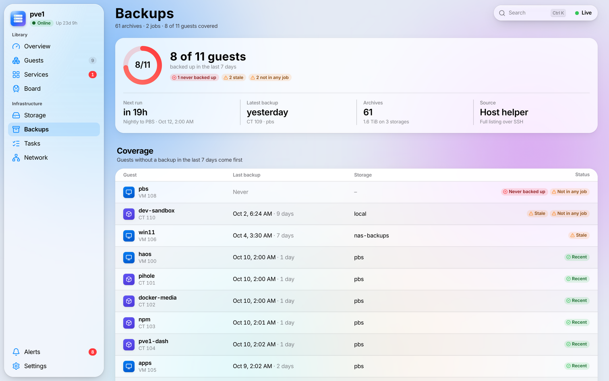
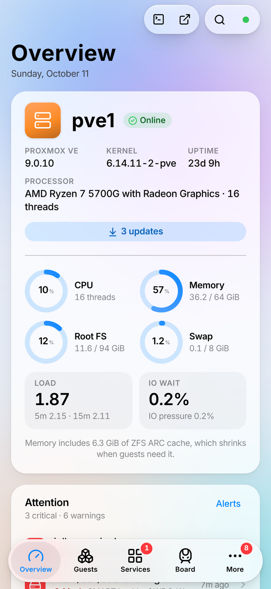
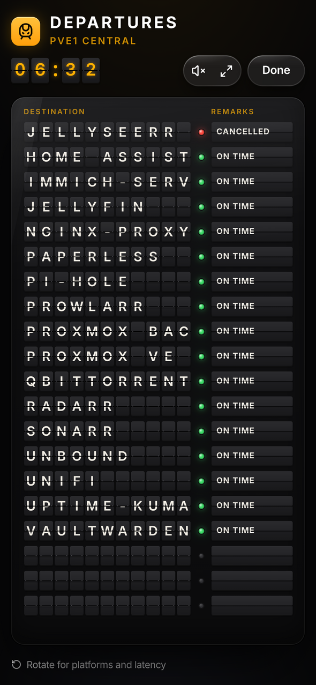

# 🚉 pve1-dash

**A read-only homelab dashboard for one Proxmox VE node, dressed like a native Apple app.**

🎉 The Proxmox web UI is great for *doing* things. pve1-dash is for *looking*: a calm, glassy (macOS/iOS 26 "Liquid
Glass" style) dashboard you can leave open on a Mac, pin to an iPad, or add to your iPhone's Home Screen, with push
alerts when something breaks. And because a status page deserves some joy, your services also show up on a
retro-futuristic **split-flap train-station departure board**. 🚂

It is **pure information**: no power buttons, no consoles of its own, no config changes. Console buttons just open
Proxmox's own console. Works with **Proxmox VE 8.x and 9.x**.

> **Note:** this repository used to hold the *Tiny Ecowitt Monitor* Windows app. That project lives on in the git
> history (any commit before `6ace15e`); the repo is now home to pve1-dash.

## 🌟 Features

| | |
|---|---|
| **Overview** | CPU, memory, root FS and swap rings, load and IO wait, live and historical charts, network, and an "Attention" card that lists only what needs a look. |
| **Guests** | Every VM and container with status, CPU/memory meters, IPs, tags and sparklines, as a grid or a sortable list. |
| **Inside your guests** | Running services, Docker containers (with health and compose project), IP addresses and listening ports, collected read-only over SSH (`pct exec` for containers, the QEMU guest agent for VMs, direct SSH for VMs without it). |
| **Service launcher** | Big tiles for your apps with health checks (HTTP or TCP), latency, 24 h uptime strips. Docker containers with published ports appear automatically. |
| **Departure board** | Your services as a fullscreen split-flap board: ON TIME, DELAYED, CANCELLED. Optional clack sound. |
| **Storage, ZFS & disks** | Pools with usage meters, ZFS health and vdev tree, SMART health and SSD wear per disk. |
| **Backups** | Coverage per guest ("backed up in the last N days?"), jobs and next runs, recent backup tasks and files. |
| **Tasks** | The Proxmox task list with readable names, durations and logs. |
| **Network** | Bridges and interfaces, every guest's addresses, and all open ports across guests. |
| **Alerts + Web Push** | Node unreachable, guest stopped, service down, unhealthy container, failed/stale backup, storage filling up, disk or ZFS trouble, straight to your iPhone (iOS 16.4+), iPad or Mac. |
| **Temperatures** | CPU/board temperatures from the host (optional lm-sensors) and disk temperatures from SMART. |
| **Feels native** | Light/dark, Reduce Transparency, spring animations, ⌘K Spotlight search, installable PWA. |

### 📸 Screenshots

| | |
|---|---|
|  |  |
|  |  |
|  |  |
|  |  |
|  |  |

## 🚀 Quick start: try the demo

No Proxmox needed: the demo runs a simulated homelab (a mock Proxmox API and fake guests). You need Node.js 20.19 or
newer (22+ to run the test suite).

```bash
git clone https://github.com/orangesunshine321/Tiny-Ecowitt-Monitor.git pve1-dash
cd pve1-dash
npm ci && npm run build && npm run demo
```

(Before pve1-dash is merged into `main`, clone its branch: add `--branch claude/homelab-dashboard-pve1-dizt16` to the
`git clone` line.)

Then open <http://localhost:8080>. (Port taken? `PVE1_DASH_PORT=8081 npm run demo`.)

## 🏠 Install on your Proxmox host

On **pve1**, as root (the web UI's node → **Shell** is fine):

```bash
bash -c "$(curl -fsSL https://raw.githubusercontent.com/orangesunshine321/Tiny-Ecowitt-Monitor/main/deploy/install.sh)"
```

> **Before pve1-dash is merged into `main`:** the repository's `main` branch still holds the old *Tiny Ecowitt
> Monitor*, so the command above finds no installer there (and ends without doing anything). Until the merge, install from the pve1-dash branch. Name
> the branch twice: in the URL (which installer to download) and in `PVE1_DASH_REF` (which code the installer builds):
>
> ```bash
> PVE1_DASH_REF=claude/homelab-dashboard-pve1-dizt16 bash -c "$(curl -fsSL https://raw.githubusercontent.com/orangesunshine321/Tiny-Ecowitt-Monitor/claude/homelab-dashboard-pve1-dizt16/deploy/install.sh)"
> ```
>
> The installer remembers the branch in the container, so updates and re-runs stay on it. Once the branch is merged
> into `main`, the plain command above works. If the ref you give doesn't contain pve1-dash, the installer stops right
> at the start and says so.

It asks a few questions with sensible defaults, shows a plan, and then:

1. creates an **unprivileged Debian 13 container** (tagged `pve1-dash`, no root password, starts on boot; Debian 12
   on hosts whose `pve-container` is too old for Debian 13);
2. creates a **read-only API token** (`pve1dash@pve!dashboard`, role `PVEAuditor`; a second dashboard in the same
   cluster gets its own token);
3. installs **Node.js 24 LTS** and builds pve1-dash inside the container as a sandboxed systemd service;
4. installs a small **read-only SSH helper** on the host and authorizes the dashboard's key for it only;
5. optionally installs **lm-sensors** for temperatures, and runs a smoke test.

Then put it behind your HTTPS reverse proxy ([recipes for Nginx Proxy Manager, nginx, Caddy and
Traefik](deploy/reverse-proxy/README.md)), add it to your iPhone's Home Screen and enable notifications in
Settings. Every step, and how to do it by hand, is in **[docs/SETUP.md](docs/SETUP.md)**.

| What | Command |
|---|---|
| Update | `pct exec <ctid> -- pve1-dash-update` |
| Refresh the host helper (when the update tells you; it prints the exact command) | `bash -c "$(curl -fsSL …/deploy/install.sh)" -- --update-helper` |
| Repair, re-pin the certificate, change the container's network | run the installer again (it keeps your config, data and the branch or tag you installed) |
| Uninstall | `bash -c "$(curl -fsSL …/deploy/uninstall.sh)"` (add `-- --yes` for no questions) |
| Something's off | [docs/TROUBLESHOOTING.md](docs/TROUBLESHOOTING.md) |

`…` stands for `https://raw.githubusercontent.com/orangesunshine321/Tiny-Ecowitt-Monitor/main` (or
`…/claude/homelab-dashboard-pve1-dizt16` before the merge, see above).

### 📋 Requirements

- Proxmox VE **8.x or 9.x** (one node; a cluster is fine, the dashboard shows one node, and each node can have its
  own dashboard).
- ~1 GiB RAM and 6 GiB disk for the container; internet access while installing.
- An HTTPS reverse proxy on your LAN with a certificate your devices trust (for the PWA and push).
- For push on iPhone/iPad: **iOS/iPadOS 16.4+**, with the dashboard added to the Home Screen.

## 🛡️ Security model, in short

- **Read-only API token** with the built-in `PVEAuditor` role. On PVE 8 the dashboard deliberately does **not** ask for
  `VM.Monitor`, because that privilege also allows running commands inside guests.
- **One SSH key, pinned to one read-only script** with `restrict,command="..."`: it can't open a shell, forward ports or
  run anything else. It inspects running guests with a fixed script and reads a few files Proxmox already keeps.
- **TLS to Proxmox is pinned**: the token is never sent before the certificate checks out.
- **No login, LAN only.** Keep it behind your proxy and never port-forward it; add an IP allow-list or SSO at the
  proxy if your LAN isn't just you.
- Strict Content-Security-Policy, no third-party scripts, secrets only in the container with tight permissions.

The full threat model is in **[docs/SECURITY.md](docs/SECURITY.md)**.

## 🧑‍💻 Development

```bash
npm ci
npm run dev          # API in demo mode + Vite dev server (http://localhost:5173, proxies /api to :8080)
npm test             # vitest
npm run typecheck    # server and web TypeScript
npm run build        # web (Vite) → dist/web, server (esbuild) → dist/server/index.js
npm start            # run the build (needs /etc/pve1-dash/config.yaml or PVE1_DASH_CONFIG)
npm run demo         # the build's web app + the server in demo mode
```

Configuration lives in YAML: every option with its default is in
[deploy/config.example.yaml](deploy/config.example.yaml). Set `PVE1_DASH_DEMO=1` to run against the simulated
homelab.

### 🗂️ Project layout

```
server/              Fastify backend (TypeScript, ESM)
  proxmox/           read-only Proxmox API client, pollers, mapping
  inventory/         SSH runner and parsers for "what runs inside guests"
  health/            service checks and Docker discovery
  alerts/            alert rules, history, Web Push
  demo/              the simulated homelab (mock Proxmox API + mock SSH)
  http.ts            REST API, live stream (SSE), static web app
  config.ts          config schema (zod)
shared/types.ts      the data contract between server and web
web/                 React 19 PWA (Vite)
deploy/
  install.sh         host installer   · uninstall.sh · lxc-setup.sh (inside the container) · update.sh
  pve1-dash.service  systemd unit
  helpers/           the read-only SSH helpers (host and guest)
  config.example.yaml
  reverse-proxy/     proxy recipes
docs/                SETUP, SECURITY, TROUBLESHOOTING, helper protocol, design brief, research notes
tests/               vitest suites (server modules, deploy scripts with stubbed Proxmox tools)
```

## 🙏 Credits & licenses

- pve1-dash is MIT licensed (see `package.json`).
- App icons: [dashboard-icons](https://github.com/homarr-labs/dashboard-icons) by homarr-labs, **Apache-2.0**,
  loaded from jsDelivr.
- UI icons: [Lucide](https://lucide.dev), **ISC**.
- Built on [Fastify](https://fastify.dev), [React](https://react.dev), [Vite](https://vite.dev),
  [ssh2](https://github.com/mscdex/ssh2), [web-push](https://github.com/web-push-libs/web-push),
  [zod](https://zod.dev), [yaml](https://eemeli.org/yaml/), [undici](https://undici.nodejs.org) and
  [zustand](https://zustand.docs.pmnd.rs).
- Proxmox and Proxmox VE are trademarks of Proxmox Server Solutions GmbH. This project is not affiliated with them.
  Apple, iPhone, iPad, macOS and Safari are trademarks of Apple Inc.

Have fun, and may all your trains run ON TIME. 🚉
